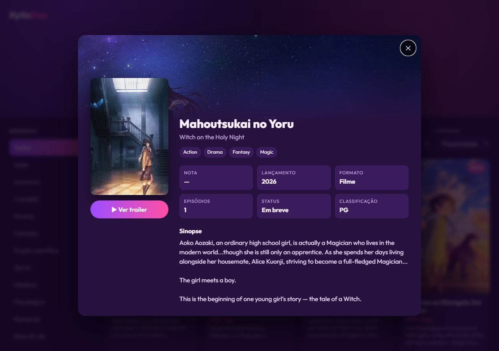

# KytizDex · Catálogo Dinâmico de Animes

Catálogo de animes que consome uma **API pública** para buscar, filtrar e exibir títulos em tempo real, com modal de detalhes, tudo sem recarregar a página. Inspirado na interface do MyAnimeList e da Pokédex.org.

**[▶ Ver demo online](https://henrysenaaa.github.io/catalogo-anime/)**


## Funcionalidades

- **Tela inicial** com barra de busca central e os destaques da temporada atual.
- **Busca em tempo real**: o `fetch` é disparado enquanto você digita, com *debounce* (uma requisição só, mesmo digitando rápido) e cancelamento das requisições antigas via `AbortController`.
- **Menu lateral de gêneros** (Ação, Romance, Terror...) e filtros por **formato** (série, filme, OVA...) e **ordenação** (popularidade, nota, recentes).
- **Cards** com capa, título, nota, ano, episódios e uma breve descrição.
- **Modal de detalhes**: nota, ano de lançamento, status, episódios, classificação, gêneros, sinopse completa e link do trailer. Fecha com `Esc`, botão ✕ ou clique fora.
- Paginação com **"Carregar mais"**, *skeleton loading*, estado vazio e tela de erro com "Tentar novamente".
- Atalho `/` para focar a busca e layout responsivo (menu de gêneros recolhível no celular).



## Tecnologias e conceitos

- HTML5, CSS3 (Grid, animações, `backdrop-filter`) e **JavaScript puro**, sem frameworks
- `fetch` + Promises, `AbortController`, debounce
- Manipulação do DOM com `createElement`/`textContent` (sem `innerHTML` para dados externos, o que evita XSS)
- API: [Kitsu](https://kitsu.docs.apiary.io), gratuita e sem chave. A Jikan API, que estava sugerida, estava fora do ar durante o desenvolvimento.

## Estrutura

```
├── index.html
├── style.css
├── js/
│   ├── logic.js   # funções puras: URLs da API, normalização dos dados, debounce
│   └── app.js     # interface: eventos, renderização, modal
└── tests/         # testes automatizados (node:test + jsdom)
```

## Como rodar

Basta abrir o `index.html` no navegador. Não precisa de build nem de servidor.

## Testes

```bash
npm install
npm test
```

São 23 testes: unitários da lógica e de interface simulando o navegador com jsdom. As respostas da API usadas nos testes foram salvas da API real (`tests/fixtures`).

## Licença

MIT
